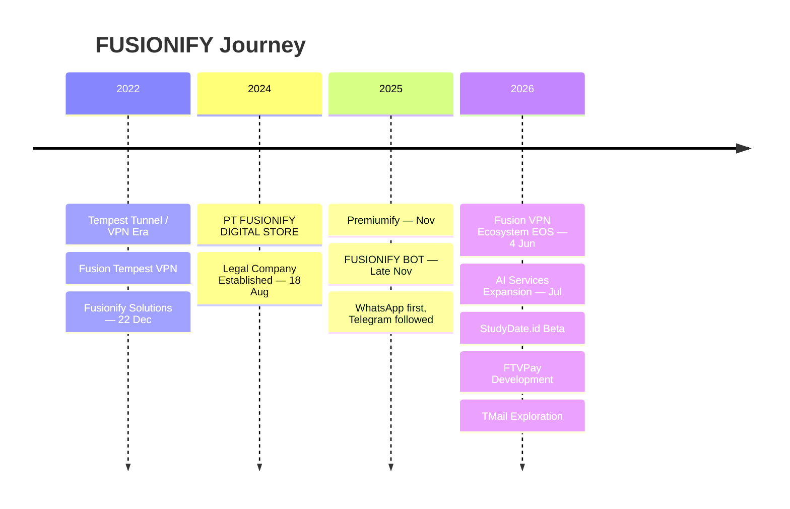

<!--
  FUSIONIFY.ID
  Official GitHub Organization Profile
  Path: .github/profile/README.md
-->

# FUSIONIFY.ID

### Software Product & Digital Technology Company

 

---

## ⚡ About FUSIONIFY

**FUSIONIFY** is an Indonesian software and technology company building products, platforms, automation systems, and digital solutions for businesses, developers, communities, and everyday users.

FUSIONIFY started as a technology project in **2022** and gradually evolved from the VPN and networking era into a broader technology ecosystem spanning services, digital commerce, automation, community platforms, payment infrastructure, and experimental projects.

> ### Before FUSIONIFY became a company, it was a project.

### **Fuse Ideas. Build Progress.**

---

## 🚀 Ecosystem

<table>
<tr>
<td width="50%" valign="top">

### 🤖 FUSIONIFY BOT

**Multi-channel commerce automation**

Automation technology for digital stores and online sellers.

**Current channels**
- WhatsApp
- Telegram

**Coming next**
- Discord
- AI-powered systems

**Core direction**

`Auto Order` `Store List` `Payments` `Digital Delivery` `Admin Panel` `Automation`

 

</td>

<td width="50%" valign="top">

### 💎 PREMIUMIFY

**Digital Products & Commerce**

A FUSIONIFY digital-commerce brand focused on premium and digital products.

Premiumify first appeared in **November 2025** and later expanded from a bot-first commerce flow into its own web presence.

**Focus**

`Digital Products` `Premium Services` `Commerce` `Automation`

 

  

🌐 [premiumify.my.id](https://premiumify.my.id/)

</td>
</tr>

<tr>
<td width="50%" valign="top">

### 🎓 STUDYDATE.ID

**Student Community & Networking Platform**

A platform for students to discover communities, build connections, join study circles, explore campus activities, and grow their academic and social network.

**Direction**

`Student Community` `Networking` `Study Circles` `Campus Events` `Connections`

 

  

🌐 [studydate.id](https://studydate.id/)

</td>

<td width="50%" valign="top">

### 💳 FTVPAY

**QRIS Payment Infrastructure**

A payment technology project focused on **QRIS-based payment infrastructure**.

FTVPay is still under development and has not yet received a public production release.

**Focus**

`QRIS` `Payments` `Transactions` `Payment Infrastructure`

 

</td>
</tr>

<tr>
<td colspan="2" valign="top">

### 🛠️ FUSIONIFY SOLUTIONS

**Technology Services • Project Assistance • Learning • Collaboration**

Fusionify Solutions is the service and collaboration side of FUSIONIFY.

It handles client work, project assistance, technical services, software development, learning support, custom requests, experimentation, and collaborative technology projects.

Since **July 2026**, Fusionify Solutions has also expanded into AI-related services and implementations.

**Services may include**

`Client Projects`
`Web Development`
`Bot Development`
`Automation`
`Technical Assistance`
`Server Setup`
`Custom Scripts`
`Learning Support`
`AI Services`
`Collaboration`

 

</td>
</tr>
</table>

---

## 📬 Future Project

<table>
<tr>
<td width="100%" valign="top">

### TMail *(working title)*

**Temporary Mail Web Project**

TMail is currently a personal/experimental temporary email web project with plans for possible public availability in the future.

The public release timeline and final product name have **not yet been determined**.

</td>
</tr>
</table>

---

## 🧬 Journey

### 2022 · The beginning

FUSIONIFY's story started from networking and VPN technology.

The early VPN projects evolved into the **Fusion Tempest VPN** ecosystem. Later in the same year, **Fusionify Solutions** started on **22 December 2022** as a services, assistance, learning, and collaboration initiative.

### 2024 · Becoming a legal company

On **18 August 2024**, **PT FUSIONIFY DIGITAL STORE** was legally established as the company operating the FUSIONIFY brand.

### 2025 · Expanding beyond VPN

FUSIONIFY expanded into new categories.

**Premiumify** strengthened the digital-commerce direction, while **FUSIONIFY BOT** introduced commerce automation.

FUSIONIFY BOT began from the **WhatsApp Store List** side. A few days later, its **Telegram Auto Order** line began development on **26 November 2025**.

### 2026 · A broader technology ecosystem

The official **Fusion VPN Ecosystem** reached end of service on **4 June 2026**, while FUSIONIFY continued expanding into new categories.

New directions included:

- AI-related technology services
- Student community platforms
- QRIS payment infrastructure
- Multi-channel automation
- Experimental web services

> **The VPN journey ended. The FUSIONIFY journey continues.**

---

## 🕰️ Legacy

### FUSION TEMPEST VPN

**The beginning of the FUSIONIFY technology journey.**

The VPN era remains an important part of FUSIONIFY's history.

Its broader historical ecosystem included:

`Tempest Tunnel`
`Tempest VPN`
`Fusion Tempest`
`Fusionify Injector`
`FTV Injector`

The **Fusion VPN Ecosystem** officially reached end of service on **4 June 2026**.

> ### The Journey Ends. The Legacy Remains.

---

## 🤝 Partnerships

<table>
<tr>
<td align="center" width="25%">

### GRETONGERS.ID

Long-term ecosystem partner since the early **Tempest VPN** era.

</td>

<td align="center" width="25%">

### PT RAJA SERVER PREMIUM

Ecosystem partner since the **Fusion Tempest** era.

</td>

<td align="center" width="25%">

### HADYVA INTERIOR

Partner since **17 June 2026**.

</td>

<td align="center" width="25%">

### TRUSTARY STORE

Partner since **16 July 2026**.

</td>
</tr>
</table>

<b>Former Partnerships</b>

 

- **Manipulators.id** — partnership concluded on **15 February 2026**
- **MG Order** — partnership concluded on **15 February 2026**

---

## ⚙️ Technology & Engineering

  

  

`Software Products`
&nbsp;•&nbsp;
`Automation`
&nbsp;•&nbsp;
`Web Platforms`
&nbsp;•&nbsp;
`AI Systems`

`Digital Commerce`
&nbsp;•&nbsp;
`Payment Infrastructure`
&nbsp;•&nbsp;
`Developer Tools`
&nbsp;•&nbsp;
`Custom Solutions`

---

## 🧪 Labs & Experiments

Not every repository under this organization represents a commercial FUSIONIFY product.

Some repositories may contain:

- internal tools
- prototypes
- utilities
- research
- experiments
- historical projects
- future product exploration

Some ideas stay experiments. Some eventually become products.

---

## 🌏 Built from Indonesia

 

**Bogor, West Java, Indonesia 🇮🇩**

---

## 🏢 Company

### FUSIONIFY

**Software Product & Digital Technology Company**

Operated by

### PT FUSIONIFY DIGITAL STORE

Bogor, West Java, Indonesia 🇮🇩

 

  

### **Fuse Ideas. Build Progress.**

Products • Platforms • Automation • Technology • Collaboration

